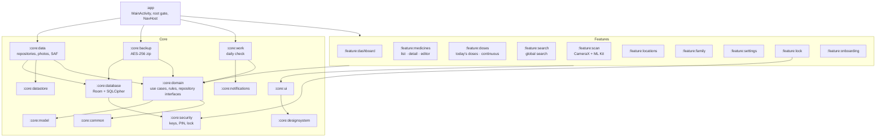

# MediShelf

An offline-first Android app for keeping track of the medicines in a family home: what you
have, who it is for and for which condition, where it is kept, and when it expires.

> MediShelf is a record-keeping tool. It does not give medical advice.

## Features

- **Inventory**: brand/generic name, strength, form, batch, barcode, quantity and low-stock
  threshold, purchase/expiry/opened dates with "use within X days of opening", storage
  location, photos (box, strip, prescription), notes.
- **Prescriptions**: prescriber, **prescribed for** (family member and reason/condition),
  prescription date, course **start and end dates**, dosage directions, and an optional course
  dose (amount × times per day).
- **People and conditions**: link a medicine to one or more family members, each with the
  condition it treats; per-person view of current and past medicines; allergies shown up front.
- **Where is it?**: everything grouped by storage location (fridge locations flagged).
- **Dashboard**: expired / expiring in 30 days / low-stock counts, today's doses, and what
  needs attention.
- **Doses (continuous medication)**: record medicines taken every day (dose, times per day,
  who takes it, start and optional end). Prescriptions with a course dose are listed until their
  end date. Each dose is ticked off by hand, and **stock goes down only for doses confirmed as
  taken** (un-ticking puts it back). Medicines without a schedule are never touched. Shows days
  of stock left and warns when a course would run out before its end date.
- **Global search**: one search over medicine name, composition, strength, doctor, who and what
  it is prescribed for, conditions, people, allergies, storage places, manufacturer, batch,
  barcode, dosage and notes. Case- and accent-insensitive, every word must match, results say
  which field matched, and finished/disposed medicines appear last.
- **Search and filters**: by name, ingredient, condition or person; filter by person, location,
  status, form, expiry window, low stock; sort by expiry or name.
- **Scan pack (on-device only)**: photograph each side of the box; every photo gets full OCR
  plus barcode/DataMatrix detection, and the results from all sides are merged. Brand name,
  active ingredients, strength, form, pack size, manufacturer, expiry, batch, prescription-only
  marking, dosage directions, storage notes, "use within N days of opening" and barcode are
  offered on one review screen. Pharmacy stickers also yield the patient (matched to a family
  member, with the condition), prescriber and dispensing date; a "keep in a fridge" note picks
  a fridge location. The editor marks every filled field for the user to check before saving,
  and the review screen can show the raw OCR text. GS1 DataMatrix expiry and batch take
  priority over OCR, and a barcode seen before prefills from the saved pack. A quick
  **barcode only** scan is also available.
- **On-device medicine NLP** (`core:nlp`): a dictionary entity recogniser finds ingredients,
  brands and manufacturers even on packs with no "Active ingredient:" style keywords. It
  matches multi-word names longest-first and tolerates OCR errors (`PARACETAM0L`,
  `Amoxicilin`) through digit/letter repair and a Levenshtein BK-tree. Nothing is downloaded.
- **Lifecycle and history**: mark used (reduces quantity), finished, disposed or restore.
  Records are never hard-deleted; every change is logged. Safe-disposal guidance is shown for
  expired items.
- **Reminders**: a daily background check notifies before expiry (configurable, e.g. 30/7/1
  days), on expiry and on low stock. Lock-screen notifications never show medicine names.
- **App lock**: PIN (PBKDF2-hashed, throttled) with optional strong biometrics; forgot-PIN
  recovery via the phone's own screen lock; screenshots and the recents preview are blocked
  while the lock is on.
- **Backup and export**: AES-256 password-protected backup (records + photos) saved anywhere
  through the system file picker, with full restore; CSV export for a doctor, optionally per person.
- **Accessibility**: labels and 48dp touch targets checked by tests, large-text layouts,
  dark mode.

## Privacy

- **No `INTERNET` permission.** The release workflow fails if any dependency adds it.
- No accounts, ads or analytics. ML Kit runs with **bundled** models and its telemetry
  backend is removed from the manifest.
- The database is encrypted with SQLCipher. Android auto-backup and device transfer are
  disabled; the only way data leaves the phone is a backup or CSV the user saves.

## Requirements

| Tool | Version |
|---|---|
| Android Studio | A release that supports AGP 9.4 (bundled JBR is fine) |
| JDK | 17 or newer (CI uses 21) |
| Android SDK | Platform 37 (Android 17); build-tools are fetched by AGP |
| Device | Android 8.0 (API 26) or newer |

## Build and run

```bash
./gradlew assembleDebug
```

```bash
./gradlew installDebug
```

The debug build installs as `com.medishelf.debug` next to a release install. In a debug
build, **Settings → Developer → Demo data** loads a sample family with medicines in every
state (expired, expiring, low stock, finished, disposed); turning it off removes only those
records. **Run reminder check now** triggers the daily job immediately.

## Tests

```bash
./gradlew test testDebugUnitTest lintDebug
```

This runs the JVM test suite: domain rules (validation, expiry, reminders, GS1/full-label parsing,
CSV), Room DAO and repository tests, encrypted-backup round trips, the reminder worker,
ViewModels, Compose UI flows and an accessibility audit of every main screen (Robolectric).

The on-device accessibility test runs Google's Accessibility Test Framework (contrast, touch
targets, labels) against the real app. It expects a fresh install:

```bash
adb uninstall com.medishelf.debug; ./gradlew :app:connectedDebugAndroidTest
```

The pack-scan device tests render a box side (with a real EAN-13 barcode) and a keyword-free
box with a pharmacy sticker, and run the bundled ML Kit OCR and barcode models plus the
parser over them:

```bash
./gradlew :feature:scan:connectedDebugAndroidTest
```

SQLCipher itself only runs on a device or emulator; JVM tests use an in-memory Room database.

## Architecture

MVVM with Clean Architecture layers, one Gradle module per layer/feature, Hilt for DI,
Kotlin Coroutines and Flow throughout, Jetpack Compose (Material 3) UI.



**Dependency rules**

- Feature modules depend on `core:domain`, `core:model`, `core:ui` and `core:designsystem`
  only, never on `core:data` or `core:database`. The exception is `feature:lock`, which
  uses `core:security` for biometric prompts and the lock state.
- `core:domain`, `core:model`, `core:common` and `core:testing` are pure Kotlin/JVM; the
  business rules are tested without Android.
- `:app` wires implementations to interfaces through Hilt and owns navigation.

**Key decisions**

| Area | Decision |
|---|---|
| Status | Stored `ACTIVE/EXPIRED/FINISHED/DISPOSED`; the UI uses an *effective* status, so an item shows as expired on its date even before the daily job runs. Effective expiry = earlier of printed expiry and opened + "use within" days. |
| Search | In-memory filtering in `core:domain` (a household has at most a few thousand rows), so search covers names, conditions and people and is fully unit-tested. |
| Encryption key | 32 random bytes wrapped by a non-exportable Android Keystore key, used as a SQLCipher raw key. It is **not** derived from the PIN, so reminders work while the app is locked. |
| App lock | A root gate replaces the whole navigation tree while locked, so deep links and back stacks can't bypass it. |
| Reminders | `ReminderPlanner` (pure Kotlin) fires each threshold once, survives missed days, and re-arms after edits or restocking. |
| Backup | `manifest.json` + `data.json` + `photos/` in an AES-256 zip (opens in 7-Zip with the password). Restore validates everything first, replaces data in one transaction, and blocks zip-slip and oversized entries. Settings and the PIN are not included. |
| Doses | `dose_schedules` + `dose_logs` (unique per schedule/day/slot). Ticking a dose writes the log and lowers stock in one transaction, so a dose can't be counted twice. A prescription's course dose is kept as a schedule that ends on the prescription end date. |
| Migrations | Room auto-migration 1 → 2 (new columns and tables only), checked by `MigrationTestHelper` against the exported schemas. Backups are format 2; format 1 files still restore. |

### Project structure

```
app/                      MainActivity, root gate, NavHost, Application (WorkManager + Hilt)
build-logic/convention/   Gradle convention plugins (android app/library, compose, hilt, room, feature, jvm)
core/
  model/ common/ domain/  pure Kotlin: entities, rules, use cases, parsers, planners
  nlp/                    pure Kotlin: medicine lexicons and OCR-tolerant entity recogniser
  database/ datastore/    Room + SQLCipher, DataStore (settings, lock state, reminder ledger)
  data/ backup/           repositories, photo store, SAF documents, demo data, backup service
  security/               database key, PIN hashing, lock manager, biometrics
  notifications/ work/    reminder notifications, daily WorkManager job
  designsystem/ ui/       theme and status colours, shared composables
  testing/                fakes and test helpers
feature/                  dashboard, medicines, doses, search, scan, locations, family, settings, lock, onboarding
gradle/libs.versions.toml version catalog
scripts/                  build_lexicon.py (refreshes the FDA lexicons)
```

### Medicine lexicons

`core/nlp/src/main/resources/medishelf/lexicon/` holds the dictionaries (~13k entries, ~150 KB):

- `fda_*.txt`: ingredients, brand names and companies from the US FDA
  [Drugs@FDA](https://www.fda.gov/drugs/drug-approvals-and-databases/drugsfda-data-files)
  data files, which are public domain.
- `curated_*.txt`: INN names (paracetamol, salbutamol, …) and brands and manufacturers common
  outside the US (Panadol, Adol, Julphar, Hikma, …).
- `synonyms.txt`: INN/USAN pairs such as `PARACETAMOL = ACETAMINOPHEN`.

To refresh the FDA lists, download and unzip the Drugs@FDA data files, then run:

```bash
python3 scripts/build_lexicon.py path/to/drugsatfda path/to/core/nlp/src/main/resources/medishelf/lexicon
```

## Signed releases

Every tag like `v1.2.3` runs `.github/workflows/release.yml`, which:

1. runs all tests and lint;
2. builds a signed App Bundle plus signed APKs (arm64-v8a, armeabi-v7a, x86_64 and universal);
3. verifies the signatures and fails if any APK requests `INTERNET`;
4. publishes a GitHub Release with the files and a `SHA256SUMS.txt`.

`versionName` comes from the tag (`1.2.3`), and `versionCode` = major × 1,000,000 +
minor × 1,000 + patch (`1002003`).

### 1. Create a keystore (once)

```bash
keytool -genkeypair -v -keystore medishelf-release.jks -alias medishelf -keyalg RSA -keysize 4096 -validity 10000
```

Keep this file and its passwords somewhere safe (a password manager). If you publish on
Google Play, enrol in **Play App Signing** and use this key as the *upload key*, so a lost
key can be reset.

### 2. Build a signed release locally (optional)

Create `keystore.properties` in the project root. It is git-ignored, so never commit it:

```properties
storeFile=/absolute/path/to/medishelf-release.jks
storePassword=...
keyAlias=medishelf
keyPassword=...
```

```bash
./gradlew bundleRelease -PabiSplits=false -PversionName=1.0.0 -PversionCode=1000000
```

```bash
./gradlew assembleRelease -PversionName=1.0.0 -PversionCode=1000000
```

The App Bundle and the per-ABI APKs are built in separate runs, because AGP can't produce the
bundle alongside ABI-split APKs when resource shrinking is on.

Outputs are written to `app/build/outputs/apk/release/` and
`app/build/outputs/bundle/release/`. Environment variables `MEDISHELF_KEYSTORE_PATH`,
`MEDISHELF_KEYSTORE_PASSWORD`, `MEDISHELF_KEY_ALIAS` and `MEDISHELF_KEY_PASSWORD` take
precedence over the file. Without either, release builds are produced unsigned.

### 3. Add the GitHub secrets (once)

In the repository, open **Settings → Environments**, create an environment named `release`
(optionally with required reviewers), and add:

| Secret | Value |
|---|---|
| `ANDROID_KEYSTORE_BASE64` | output of the command below |
| `ANDROID_KEYSTORE_PASSWORD` | keystore password |
| `ANDROID_KEY_ALIAS` | `medishelf` (or your alias) |
| `ANDROID_KEY_PASSWORD` | key password |

```bash
base64 -i medishelf-release.jks | pbcopy
```

(On Linux: `base64 -w0 medishelf-release.jks`.)

### 4. Release

```bash
git tag v1.0.0 && git push origin v1.0.0
```

The workflow's actions are pinned to commit SHAs because the job handles the signing key.
When updating an action, pin the new release's SHA, not a moving tag.

## Known limitations

- Ingredient, brand and manufacturer recognition only knows names in the lexicons; an
  unlisted local brand is still offered from the largest text on the pack, but may rank lower.
- Pack OCR uses ML Kit's Latin-script model. It is tested against realistic label text and a
  rendered box on a device, but not yet against a wide range of real, glossy or curved packs.
- Biometric unlock and the Android 8–10 forgot-PIN path have not been tried on physical
  hardware.
- If the Android Keystore is wiped (factory reset, some security updates), the encrypted
  database can't be opened. The app explains this and offers to start fresh so a backup can
  be restored, which is why regular backups matter.
- Doses are confirmed by hand; there are no dose-time notifications yet, and only today's doses
  can be ticked (a missed day can be corrected with "Mark used" on the medicine).
- English only. All text is in `strings.xml`, ready for translation.
